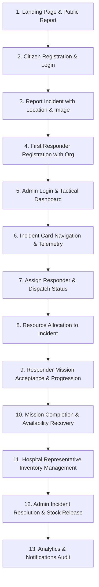

# CrisisChain: Complete End-to-End Testing Guide & Manual Execution Protocol

**Document Version:** 1.0.0  
**Target Environment:** Localhost / Pre-Release Staging  
**Frontend URL:** `http://localhost:5173`  
**Backend API URL:** `http://localhost:5001/api`  
**Database:** MySQL 8.0+ (`crisischain_db`)  

---

## 1. Prerequisites & Environment Setup

### 1.1 Software Requirements
* **Node.js:** v18.0.0 to v24.x (Tested with Node v24.19.0)
* **npm:** v9.0.0+
* **MySQL Server:** 8.0.16 or higher (Supports `CHECK` constraints, JSON, and transactions)
* **Web Browser:** Google Chrome / Microsoft Edge / Mozilla Firefox with Developer Tools enabled

### 1.2 System Ports
* **Port 5001:** CrisisChain Express Backend Server
* **Port 5173:** CrisisChain Vite Frontend Development Server
* **Port 3306:** MySQL Database Service

### 1.3 Environment Configuration
Ensure `server/.env` exists and contains:
```env
PORT=5001
DB_HOST=localhost
DB_USER=root
DB_PASSWORD=your_mysql_password
DB_NAME=crisischain_db
JWT_SECRET=your_jwt_secret_key
CORS_ORIGIN=http://localhost:5173
```
*(Never commit `.env` with actual passwords to public Git repositories).*

---

## 2. Server Startup Sequence

### Step 1: Start MySQL
Ensure MySQL service is running. In Windows PowerShell:
```powershell
Get-Service -Name MySQL* | Start-Service
```

### Step 2: Start Backend Server
```powershell
cd C:\Users\LENOVO\OneDrive\Desktop\CRISISCHAIN-MY\server
node index.js
```
*Expected Console Output:*
```
✅ MySQL connected to crisischain_db
🚀 Server running on port 5001
🌐 API: http://localhost:5001/api
```

### Step 3: Start Frontend Client
In a separate terminal:
```powershell
cd C:\Users\LENOVO\OneDrive\Desktop\CRISISCHAIN-MY
npm run dev
```
*Expected Console Output:*
```
  VITE v8.0.10  ready in 450 ms
  ➜  Local:   http://localhost:5173/
```

---

## 3. Pre-Seeded Test Credentials

| Role | Email | Password | Assigned Organization | Primary Workspace |
| :--- | :--- | :--- | :--- | :--- |
| **System Admin** | `admin@crisischain.com` | `admin123` | Crisis Command HQ | `/dashboard`, `/alerts`, `/resources`, `/analytics`, `/settings` |
| **Civilian Citizen** | `asha@example.com` | `password123` | N/A | `/report`, `/alerts` |
| **First Responder** | `ravi.paramedic@example.com` | `password123` | KMC Hospital Mangaluru | `/org`, `/alerts` |
| **First Responder (Fire)**| `meera.fire@example.com` | `password123` | Mangaluru Fire Services | `/org`, `/alerts` |
| **Hospital Representative** | `anil.kmc@example.com` | `password123` | KMC Hospital Mangaluru | `/hospital-resources`, `/alerts` |

---

## 4. Master Manual Testing Procedure (Exact Execution Order)



---

### PHASE 1: Public Landing Page & Incident Reporting

#### TC-01: Public Portal Exploration
* **Role:** Unauthenticated Guest
* **Preconditions:** Server and client running.
* **Steps:**
  1. Open browser and navigate to `http://localhost:5173/`.
  2. Verify navbar displays: Logo, `CRISISCHAIN`, Navigation links, `REPORT EMERGENCY` button, `LOGIN` button.
  3. Scroll down through Hero Section, Live Geospatial Radar, Active Protocols, and Regional Resource Metrics.
* **Expected Result:** Page renders with cyberpunk dark tactical theme, animated grid sweep, and zero console errors.

#### TC-02: Public Emergency Report Submission (Device GPS / Network IP)
* **Role:** Civilian / Guest
* **Preconditions:** On Landing Page.
* **Steps:**
  1. Click `REPORT EMERGENCY` or navigate directly to `http://localhost:5173/report`.
  2. Observe the Section 01 Location input box.
  3. Click `USE DEVICE GPS`.
  4. If browser location access is granted, observe the coordinate acquisition.
     * *Note on Astronomical Anomaly Detector:* If the device's Wi-Fi database returns a reading displaced $>3.5\text{h}$ from the system timezone (such as Brazil coordinates on an Indian system clock), the system triggers the toast: `Wi-Fi database reported anomalous location (...). Auto-switching to verified network location...` and switches to the verified Indian regional network location.
  5. Click `APPROX IP FALLBACK` button to verify network-based ISP positioning.
  6. Scroll down to interactive Leaflet map. Click or drag the red tactical marker to adjust coordinates.
  7. Fill Section 02 Event Details:
     * Select Incident Type: `Fire`
     * Select Threat Level: `Critical` (Red border)
     * Description: `High intensity commercial fire detected near commercial market complex.`
  8. Attach incident photo via drag-and-drop or file picker (JPG/PNG).
  9. Click `TRANSMIT EMERGENCY REPORT`.
* **Expected Result:** Form validates, loading pulse displays `Submitting emergency report payload`, and confirmation screen appears: `REPORT RECEIVED - HELP IS ON THE WAY` with Report ID (e.g. `#RI-XXXXXX`).
* **Database Verification:**
  ```sql
  SELECT incident_id, title, incident_status, priority_level, latitude, longitude, image_url 
  FROM incident ORDER BY incident_id DESC LIMIT 1;
  ```
  `incident_status` must be `'Reported'` and `image_url` must point to `/uploads/incident-...`.

---

### PHASE 2: Authentication & Multi-Role Signup

#### TC-03: Civilian Signup & Session
* **Role:** New Citizen
* **Steps:**
  1. Navigate to `http://localhost:5173/register`.
  2. Enter Full Name: `Aarav Sharma`, Phone: `9876500001`, Email: `aarav@example.com`, Password: `Password@123`.
  3. Leave role as `CITIZEN`.
  4. Click `REGISTER`.
* **Expected Result:** User is created and redirected to `/alerts`. JWT token is saved in `localStorage.getItem('token')`.
* **Database Verification:**
  ```sql
  SELECT user_id, full_name, email, role FROM users WHERE email = 'aarav@example.com';
  ```

#### TC-04: First Responder Registration with Organization Linkage
* **Role:** New First Responder
* **Steps:**
  1. Log out or open an Incognito window. Navigate to `http://localhost:5173/register`.
  2. Enter Name: `Vikram Singh`, Phone: `9876500002`, Email: `vikram.fire@crisischain.org`, Password: `Password@123`.
  3. Under Role dropdown, select `FIRST RESPONDER`.
  4. Notice the dynamic Organization dropdown appears:
     Select `Mangaluru Fire and Emergency Services` (Org ID 6).
  5. Click `REGISTER`.
* **Expected Result:** Registration completes successfully. Redirected to `/org`.
* **Database Verification:**
  ```sql
  SELECT u.user_id, u.full_name, u.role, ap.authority_type, ap.availability_status, o.name 
  FROM users u
  JOIN authority_profile ap ON u.user_id = ap.user_id
  JOIN organization o ON ap.org_id = o.org_id
  WHERE u.email = 'vikram.fire@crisischain.org';
  ```
  Both `users` and `authority_profile` rows exist; `availability_status` is `'Available'`.

#### TC-05: Hospital Representative Registration
* **Role:** New Hospital Rep
* **Steps:**
  1. Navigate to `http://localhost:5173/register`.
  2. Enter Name: `Dr. Ramesh Shenoy`, Phone: `9876500003`, Email: `ramesh.kmc@crisischain.org`, Password: `Password@123`.
  3. Select Role: `HOSPITAL REPRESENTATIVE`.
  4. Select Organization: `KMC Hospital Mangaluru` (Org ID 1).
  5. Click `REGISTER`.
* **Expected Result:** User created with role `hospital`, linked to Org 1. Redirected to `/hospital-resources`.

---

### PHASE 3: Admin Operations & Incident Command

#### TC-06: Admin Login & Overview Dashboard
* **Role:** System Admin
* **Steps:**
  1. Navigate to `http://localhost:5173/admin`.
  2. Enter Email: `admin@crisischain.com`, Password: `admin123`.
  3. Click `AUTHENTICATE COMMAND LINE`.
* **Expected Result:** Redirects to `/dashboard`.
  Top status HUD displays `SYSTEM ACTIVE`, `LIVE ALERTS`, `SAT_LINK: AETHER_GRID_STABLE`.

#### TC-07: Admin Incident Card Click & URL Deep Linking
* **Role:** System Admin
* **Steps:**
  1. On `/dashboard`, locate the `LIVE INCIDENTS` panel on the right.
  2. Click on the topmost incident card.
* **Expected Result:**
  Browser navigates immediately to `/alerts?id=1030` (or the clicked ID).
  The right panel immediately highlights that exact incident, displaying its Title, Location, Severity badge, Map Pin, Description, and photo preview.
  Browser URL retains `?id=1030`. Refreshing the page keeps the incident loaded.

#### TC-08: Dispatch Pending Status Verification
* **Role:** System Admin
* **Steps:**
  1. On `/alerts` or `/dashboard`, inspect the status badge on the incident.
* **Expected Result:**
  * For newly reported incidents: Badge shows `ACTIVE_UNASSIGNED` in yellow border.
  * For incidents with units assigned: Badge shows `DISPATCH_PENDING` in cyan border.
  * For dispatched missions in progress: Badge shows `RESPONDERS_DISPATCHED` in blue border.
  * For resolved incidents: Badge shows `RESOLVED` in emerald border.
  * Notice: Incidents with assignments NO LONGER falsely show `RESOLVED`.

---

### PHASE 4: Dispatch, Assignment & Resource Allocation

#### TC-09: Assign Responder Unit
* **Role:** System Admin
* **Steps:**
  1. On `/alerts`, select the active reported incident.
  2. Click `+ ASSIGN RESPONDER` button.
  3. The `ASSIGN TACTICAL UNIT` modal appears.
  4. Verify that newly registered responder `Vikram Singh (FireDept)` appears in the available responders list.
  5. Select `Vikram Singh` or `Ravi Kumar`.
  6. Click `CONFIRM ASSIGNMENT`.
* **Expected Result:**
  Modal closes, toast confirms assignment.
  Under "Assigned Responders", responder card appears showing Name, Org, Phone number, and Mission Status: `Pending`.
  Incident status badge updates to `DISPATCH_PENDING`.
* **Database Verification:**
  ```sql
  SELECT ia.assignment_id, ia.incident_id, ia.assignment_status, u.full_name, ap.availability_status
  FROM incident_assignment ia
  JOIN authority_profile ap ON ia.authority_id = ap.authority_id
  JOIN users u ON ap.user_id = u.user_id
  WHERE ia.incident_id = 1030;
  ```
  `ia.assignment_status` is `'Pending'`.

#### TC-10: Allocate Medical/Fire Resources
* **Role:** System Admin
* **Steps:**
  1. On `/alerts` (with the same incident selected), click `+ ALLOCATE RESOURCE`.
  2. In the modal, select Resource Center (e.g. `KMC Hospital Mangaluru`).
  3. Select Resource Type (e.g. `ICU Beds` or `Ambulance`).
  4. Enter Quantity: `2`.
  5. Click `ALLOCATE TO MISSION`.
* **Expected Result:**
  Modal closes, success toast appears.
  Resource allocation row appears under "Allocated Resources" showing `x2 ICU Beds`, Center Name, and `Active` status.
  In top incident telemetry, `Resources` shows `1 Allocated`.
* **Database Verification:**
  ```sql
  SELECT allocation_id, incident_id, resource_id, quantity_allocated, released_at 
  FROM incident_resource_allocation WHERE incident_id = 1030;
  ```
  `quantity_allocated = 2` and `released_at IS NULL`.
  Verify stock was deducted in `resource`:
  ```sql
  SELECT resource_type, quantity_available FROM resource WHERE resource_id = 1;
  ```

---

### PHASE 5: Responder Execution & Availability Cycle

#### TC-11: Responder Mission Progression
* **Role:** First Responder (`ravi.paramedic@example.com` or `vikram.fire@crisischain.org`)
* **Steps:**
  1. Log in as the assigned responder.
  2. Navigate to `/org` (Tactical Responder Dashboard).
  3. Locate the "Assigned Missions" section.
  4. Observe the newly assigned incident with status `Pending`.
  5. Click `ACCEPT MISSION`.
     * Status updates to `Accepted`.
     * Responder's profile availability changes to `Busy`.
  6. Click `EN ROUTE`.
     * Status updates to `EnRoute`. Incident status becomes `InProgress`.
  7. Click `ARRIVED ON SCENE`.
     * Status updates to `Arrived`.
  8. Click `MARK COMPLETED`.
     * Status updates to `Completed`.
* **Expected Result:**
  Mission transitions through all 5 operational phases with live timestamp logging.
  Responder availability status returns to `Available`.
* **Database Verification:**
  ```sql
  SELECT ap.availability_status, ia.assignment_status, ia.accepted_at, ia.arrived_at, ia.completed_at
  FROM authority_profile ap
  JOIN incident_assignment ia ON ap.authority_id = ia.authority_id
  WHERE ap.authority_id = (SELECT authority_id FROM authority_profile WHERE user_id = 3);
  ```
  `ap.availability_status` must be `'Available'`. `ia.assignment_status` must be `'Completed'`.

---

### PHASE 6: Hospital Resource Inventory Management

#### TC-12: Hospital Resource Live Editing & Persistence
* **Role:** Hospital Representative (`anil.kmc@example.com`)
* **Steps:**
  1. Log in and navigate to `http://localhost:5173/hospital-resources`.
  2. Verify the 4 tabs: `Beds`, `Ambulances`, `Medical Kits`, `Staff Duty`.
  3. Under `Beds` tab, click directly on the `ICU` bed card or click `EDIT`.
  4. In the pre-filled modal:
     * Change `Available Beds` from `18` to `22`.
     * Change `Status` to `Available`.
  5. Click `SAVE CHANGES`.
  6. Verify UI updates immediately to `22 Available`.
  7. Press browser Refresh (F5).
* **Expected Result:**
  After page refresh, ICU beds remain `22 Available`.
* **Database Verification:**
  ```sql
  SELECT beds FROM hospital_resources WHERE org_id = 1;
  SELECT resource_type, quantity_available FROM resource WHERE center_id = 1 AND resource_type LIKE '%ICU Bed%';
  ```
  Both the JSON document in `hospital_resources` and the row in `resource` show `22`.

---

### PHASE 7: Incident Resolution & Resource Stock Recovery

#### TC-13: Admin Final Resolution & Stock Release
* **Role:** System Admin
* **Steps:**
  1. Log in as `admin@crisischain.com` and navigate to `/alerts?id=1030`.
  2. Click the green `RESOLVE INCIDENT` button.
  3. Confirm the action.
* **Expected Result:**
  * Incident status updates to `Resolved`.
  * Status badge shows `RESOLVED` in emerald border.
  * Any remaining active assignments on this incident are marked `Completed`.
  * Assigned responders' availability status is reset to `Available`.
  * Allocated resources are marked `Released` (`released_at = NOW()`).
  * The deducted stock (e.g. 2 ICU beds) is automatically returned to `resource.quantity_available`.
* **Database Verification:**
  ```sql
  SELECT incident_status, resolved_at FROM incident WHERE incident_id = 1030;
  SELECT assignment_status FROM incident_assignment WHERE incident_id = 1030;
  SELECT status, released_at FROM incident_resource_allocation WHERE incident_id = 1030;
  ```
  `incident_status = 'Resolved'`, `resolved_at IS NOT NULL`, `released_at IS NOT NULL`.

---

## 5. Verification Matrix: Automated vs Manual vs Physical

| Test Area | Automated Script (`scratch/`) | Manual Browser Verification | Physical Device Required | Status |
| :--- | :---: | :---: | :---: | :---: |
| **API Health & Endpoints** | ✅ Verified (`test_hospital_api.js`) | Optional | No | **PASSED** |
| **Database Transactions & Schema** | ✅ Verified (`check_incident_schema.js`) | Optional | No | **PASSED** |
| **Vite Production Build** | ✅ Verified (`npm run build` 4.86s) | No | No | **PASSED** |
| **Astronomical Anomaly Logic** | ✅ Verified (`verify_all_fixes.js`) | Optional | No | **PASSED** |
| **UI Card Navigation & Deep Linking** | N/A | ⚠️ User Manual Check | No | **READY TO TEST** |
| **Modal Forms & Tab Switching** | N/A | ⚠️ User Manual Check | No | **READY TO TEST** |
| **Hardware GPS Geolocation** | N/A | ⚠️ User Manual Check | Yes (Laptop Wi-Fi / Phone) | **READY TO TEST** |
| **Camera Photo Upload** | N/A | ⚠️ User Manual Check | Yes (Camera / Phone upload) | **READY TO TEST** |

